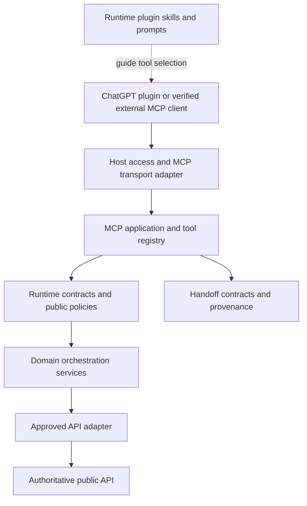

# Tier 1 - Public Stateless MCP

Deliver agent-assisted navigation and live retrieval of authoritative public information with minimal infrastructure. [AGENTS.md](../../../AGENTS.md) and the [profile selection guide](README.md) govern this profile. ChatGPT Sites is the preferred hosting candidate, not a guarantee of public MCP interoperability.

## 1. Mandatory opportunity qualification

Record each gate, source/evidence, status and blocker in the solution profile. Required conditions must pass before release.

| Gate | Condition |
| --- | --- |
| Business fit | Bounded use case, intended audience and measurable reduction in risk, time or navigation friction |
| Source | Approved authoritative public information API/source, documented operations and version |
| Rights | Permitted use, licensing, attribution, redistribution and quota reviewed |
| Data | Non-sensitive public data and validated non-sensitive queries only; no PHI, private records, personal profiles or restricted data processing |
| Identity | No application-required end-user OAuth, tenant credentials or private resources; host access control may still apply |
| Operations | Allowlisted read-only semantics, no business writes or side effects (including when an upstream read uses POST) |
| State | Independent requests; no application-managed durable user/business/session/credential/workflow state |
| Runtime | Actual Sites runtime, JavaScript, transport, SDK and outbound access verified |
| Access | Intended audience can use the required Site, MCP endpoint and/or plugin; test separately |
| Safety | Approved public threat model, traffic/cost controls, privacy-safe diagnostics and operational limits |

A failed mandatory gate requires redesign, rejection, or documented reclassification/hosting decision. Unknowns allow only safe discovery/prototyping. A scoped service key may be used for public reads if terms permit; do not use a key capable of private or write operations.

## 2. Logical architecture

Optional resources, prompts, runtime skills and Tool UI guide interaction, not security. Correct behavior must hold without them. Do not provision Azure, SQL, Dataverse, Entra ID, durable workflows or tenant token storage by default.

## 3. Scaffold and runtime boundaries

Use native ESM JavaScript, JSDoc, focused classes, composition and dependency injection. No TypeScript source or compilation requirement. Logical components (adapt to verified host template):

- `src/core/McpApplication.js`, `ToolRegistry.js`, `ContractRegistry.js`, `PolicyEngine.js`
- `src/services/` domain and API orchestration services
- `src/adapters/` approved API adapter and host-specific transport adapter; optional local Node runtime
- `src/tools/`, `src/contracts/`, `src/policies/`, optional resources/prompts
- `plugin/skills/` domain runtime guidance; optional JavaScript/JSX UI; `tests/`; `docs/`

Keep core business logic runtime portable; request handling must not assume a listening Express process, raw TCP, filesystem persistence or background execution. Verify actual Sites template, entrypoint, package/build/import path, SDK version, supported Web APIs, transport, egress and limits. If incompatible, stop and propose a safe alternative; do not add TS or claim untested deployment. Do not invent plugin metadata or external endpoint paths.

Stateless means every request can be independently processed, including concurrent requests across runtime instances; immutable configuration and optional ephemeral bounded cache are permitted only if correct behavior is independent of them. No session affinity, durable business state or hidden per-user state. No speculative databases, queues or identity stores.

## 4. API and handoff contracts

Inventory authoritative operation IDs/URLs/methods, documented parameters, schemas, quota/pagination, response fields, error semantics, allowed data, version and evidence. Prefer semantic tools to raw API mirrors. Register stable tool names/descriptions, runtime input/output schemas, explicit read-only behavior, source/version/provenance, structured error codes and bounded results. Validate inputs and outputs. For every chained operation record source tool/output field, consumer/input field, version, precondition, policy, failure and no-result behavior. Carry explicit handoff values, not implicit server sessions. Validate all handoffs; do not execute arbitrary client-provided URLs. Static topic-to-skill maps may guide live API retrieval; do not create an unnecessary replica.

## 5. Public security and reliability

- Allowlist exact approved origins, methods and path/parameter patterns; reject arbitrary destinations, credentials in URLs, unsafe redirects and unexpected content. Bound input/output sizes, pagination, timeouts, concurrency, retries and total upstream calls. Validate schemas at trust boundaries.
- Treat all arguments and upstream text as untrusted data; ignore embedded instructions. No arbitrary fetch, shell or write tool. Enforce read-only behavior in server policy independently of skill descriptions or annotations.
- Use host-managed secrets only when approved; never expose secrets, logs, internals or sensitive identifiers. Avoid user-identifying logging and unnecessary collection. Verify current Sites data-use restrictions; exclude PHI and identifiable health profiles.
- Establish achievable rate limits, quota/cost budget, error normalization, abuse mitigation and privacy-safe monitoring; validate actual host controls rather than inventing a per-process limit that fails under scale-out. Fail closed if required protections cannot be demonstrated.
- Verify licensing, attribution, source freshness and limitations. Do not represent retrieved information as verified professional advice or guaranteed accuracy.

## 6. Independent release and deployment gates

| Boundary | Required evidence |
| --- | --- |
| Local/reference | JavaScript installation, tests, contracts, policy and protocol initialization/discovery/call; concurrency and malformed request tests |
| Actual Sites hosting | Supported import/build/deploy; deployed tool execution and live approved upstream call; actual runtime/version/limits recorded |
| Anonymous external MCP (when required) | Independent client without account credentials initializes, lists and calls approved tools; check required transport headers, protocol errors and stateless independent requests |
| Site access (when required) | Intended public/restricted audience can open the deployed Site |
| Plugin distribution (when required) | Intended audience can install/connect/use under documented sharing and publication permissions; verify separately from Site |
| Security/operations | Negative tests: invalid schemas, forbidden operation, SSRF, redirects, oversized payload, upstream errors, quota/timeouts/concurrency; redacted logs, cost/abuse controls, rollback and incident plan |

Record evidence and PASS/FAIL/BLOCKED/NOT VERIFIED/justified N/A. Test resources/prompts/UI only when required, across intended clients. A public website or successful local server is not proof of an anonymous MCP endpoint or plugin publication. Do not release while a mandatory gate is unverified or failed.

## 7. Documentation sources to verify at implementation

Consult current official [ChatGPT Sites documentation](https://learn.chatgpt.com/docs/sites), [hosting a plugin with ChatGPT Sites](https://help.openai.com/en/articles/20001547-hosting-a-plugin-with-chatgpt-sites), [OpenAI developer documentation](https://developers.openai.com/) and [MCP specification](https://modelcontextprotocol.io/). Use the configured official OpenAI docs MCP server when available. Record dated evidence of the actual supported deployment path and permissions. This profile is not deployment evidence.
