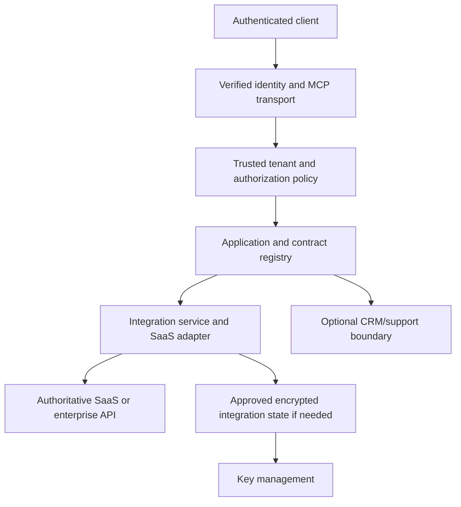

# Tier 2 - Enterprise MCP

Authenticated request-driven enterprise and SaaS integration, using native ESM JavaScript. Governed by [AGENTS.md](../../../AGENTS.md) and [profile selection](README.md). Prefer Azure-hosted Node.js when justified. Do not assume every enterprise solution needs SQL, Dataverse or Tool UI.

## 1. Qualification and boundaries

Choose when private/tenant resources, authenticated operations or authorized writes are required but durable business workflow execution is not. Record audience, tenancy, data sensitivity, system of record, permission scopes, operations and side effects, integrations, state and host selection. Review terms, regulatory obligations, data location/retention and cost. Escalate durable workflow/recovery requirements to Tier 3. No automatic downgrade to Tier 1.

## 2. Logical architecture

Separate core JavaScript classes from host adapter, policy, vendor, persistence and UI. Use explicit contracts and runtime schemas. Prefer Azure managed identity and approved secret store where supported; document identities, least privilege, network and environment separation. Tool UI and runtime skills are never security enforcement.

## 3. Identity and security

Authenticate and authorize server-side for every protected operation. Verify issuer, audience, expiry, scope and appropriate claims; derive principal and tenant/account membership from trusted context, not supplied identifiers. Explicitly bind credentials and resource lookups to trusted tenant/account, check entitlements and object access. Fail closed on missing, expired, ambiguous or conflicting context. Review cross-tenant access, confused deputy, replay, token substitution, credential lookup, refresh races, revocation, rotation, consent and scopes. Protect OAuth callbacks and correlation state as appropriate. Restrict credentials, redact logs, use approved encryption and key lifecycle. Apply all applicable security sections in AGENTS.md, including tenant and Azure identity review. Do not infer identity proof from unverified provider claims.

## 4. State, integration and write controls

Persist only approved necessary configuration, encrypted tokens, account mappings, metadata and integration state with retention/deletion and migrations. Treat SaaS as authoritative; do not replicate business data without accepted ADR. Dataverse is optional CRM/support with explicit ownership, correlation, retry/deduplication and no unnecessary copies. Review write authorization, idempotency, duplicate prevention, timeout ambiguity, auditability, safe retries and user confirmation for consequential writes. Version tool contracts and normalize failures. Business workflows requiring durable state or cross-step recovery belong in Tier 3.

## 5. Release gates

Verify JavaScript build/test, protocol and contract behavior, actual host transport/identity/secret access, tenant boundary and least privilege, negative auth tests (wrong tenant, missing/expired credentials, mismatched account, unauthorized object), token handling and rotation, provider failure and rate limits, persistence migrations and retention where used, write duplicate/retry controls, privacy-safe logs, environment separation and rollback. Verify optional UI and plugin distribution independently when required. Report PASS/FAIL/BLOCKED/NOT VERIFIED or justified N/A. No production release without applicable required gates and Principal Engineer approval for significant decisions.
