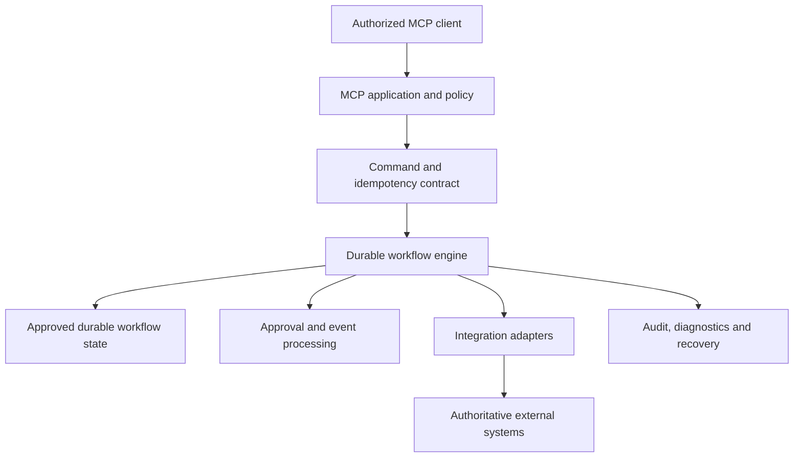

# Tier 3 - Durable Orchestration

Native ESM JavaScript MCP solutions requiring durable business execution, approvals, transactions, recovery or asynchronous processing. Governed by [AGENTS.md](../../../AGENTS.md), [profile selection](README.md), and applicable [Tier 2](tier-2-enterprise-mcp.md) identity and integration controls. Prefer Azure-hosted Node.js with justified durable services; choose actual workflow, persistence and queue technology by accepted ADR.

## 1. Qualification

Record why independent request execution is insufficient; identify workflow ownership, long-running operations, business impact, side effects, approvals, recovery objectives, durability, audit and retention. Define identity/tenant boundaries for every protected operation, including asynchronous actors and service principals. Do not adopt orchestration because a framework example uses it.

## 2. Logical architecture

MCP request handling stays request-driven. Return explicit durable correlation/status references rather than holding requests indefinitely. Use documented JavaScript classes for orchestration, commands, adapters, policies and contracts. Separate workflow state, integration credentials, domain records and optional support/CRM state.

## 3. Workflow and contract invariants

Define versioned state machine and transition/terminal rules, actor/approval authorization, correlation and idempotency keys, transactional boundaries, expected consistency, retry and backoff budgets, cancellation, timeouts, compensation and manual intervention. Do not claim exactly-once effects without proof; design for duplicate delivery and ambiguous timeouts. Use supported idempotency/reconciliation with upstream systems. Validate transitions server-side, reject stale/unauthorized approvals and enforce tenant context on workers, callbacks and status lookups. Persist necessary state and audit evidence with retention/deletion and approved encryption; never store secrets in workflow histories, event payloads or logs.

## 4. Operations and failure recovery

Define event authenticity, queue/backpressure/dead-letter handling if applicable, safe replay, poison-message handling, restart/recovery, incident ownership, monitoring, access controls, backup/restore, rollback/version migration and recovery time/data loss objectives. Validate dependencies, quota, costs and provider failure semantics. Compensation must be explicit and approved for irreversible or partial effects. Do not use an unverified workflow engine or pretend an MCP request creates durable execution automatically.

## 5. Release gates

Apply relevant Tier 2 gates. Additionally verify authorized command, approval and status contracts, duplicates/replay, out-of-order and stale events, crash/restart mid-workflow, partial failures, ambiguous write outcomes, retry/backoff, dead-letter/reconciliation, cancellation and compensation, concurrency, cross-tenant worker isolation, state migration and restore, audit completeness and documented operational runbook. Verify actual deployed runtime; report evidence PASS/FAIL/BLOCKED/NOT VERIFIED or justified N/A. Significant design decisions require Principal Engineer approval and accepted ADR; unverified mandatory gates block release.
